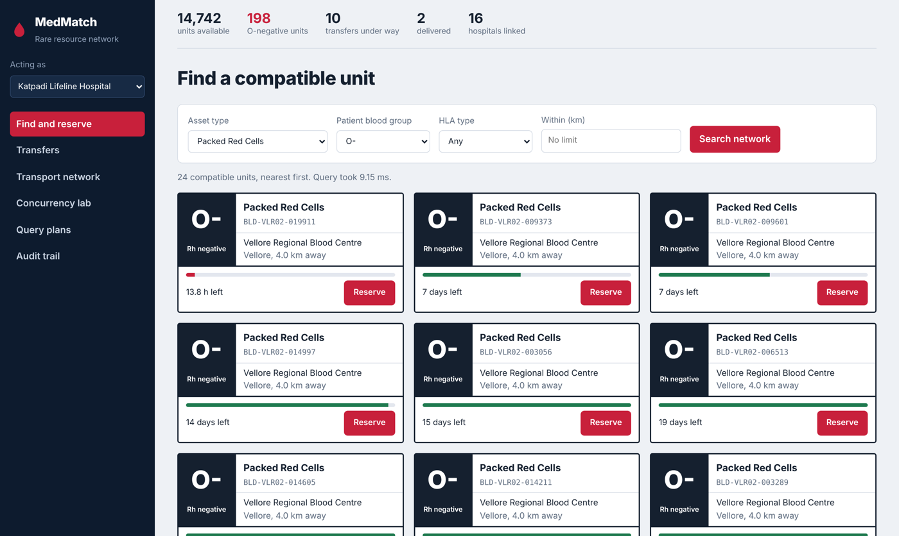
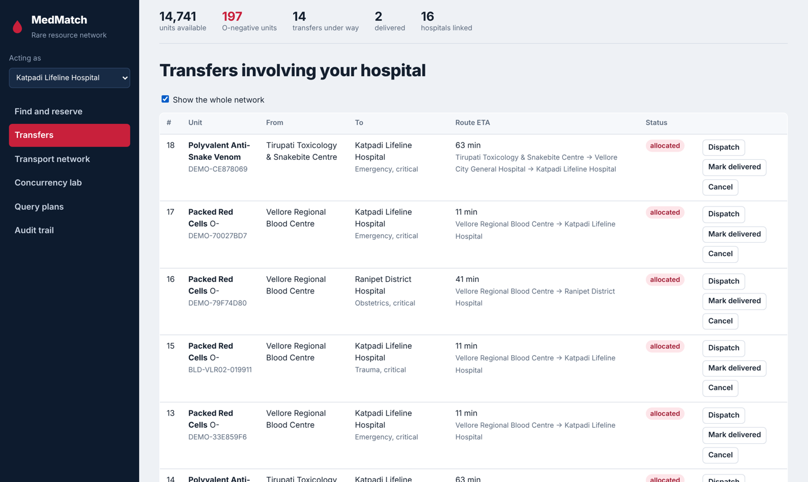
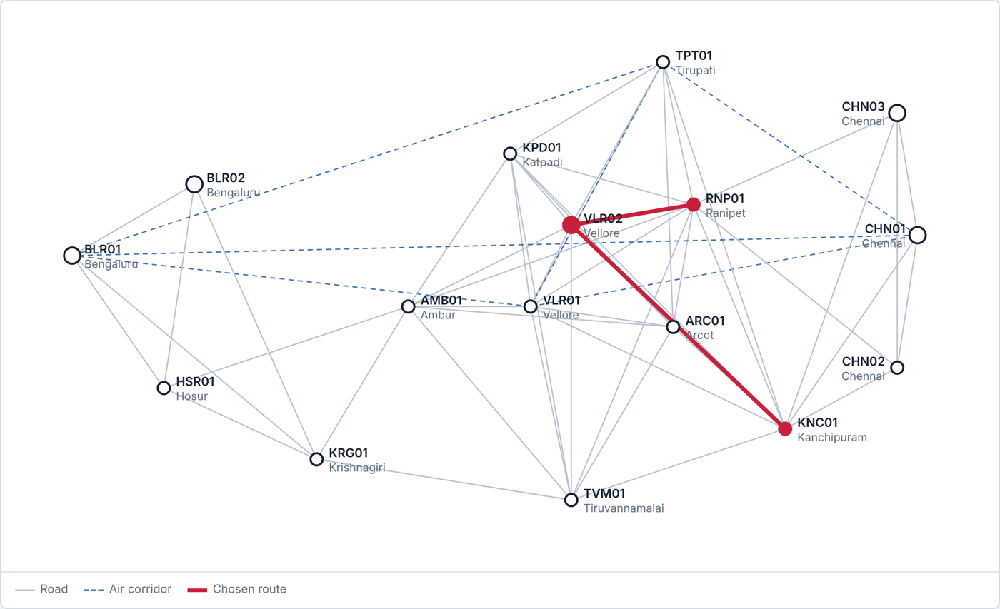
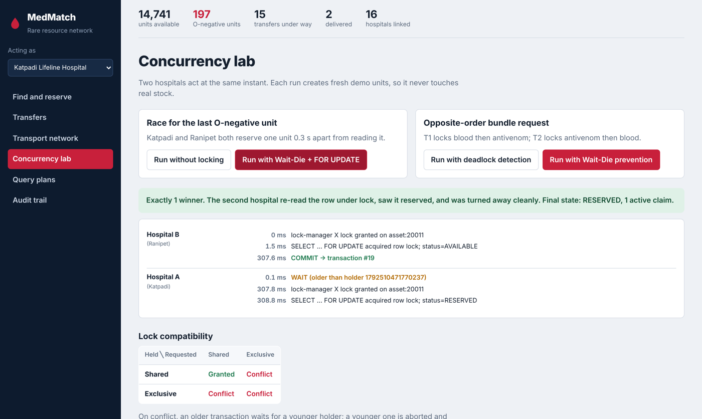
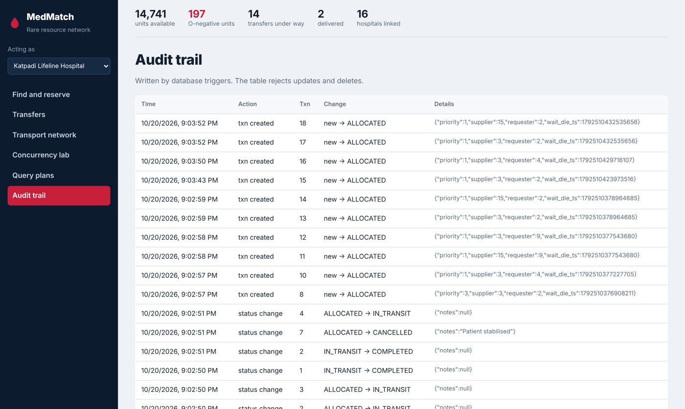
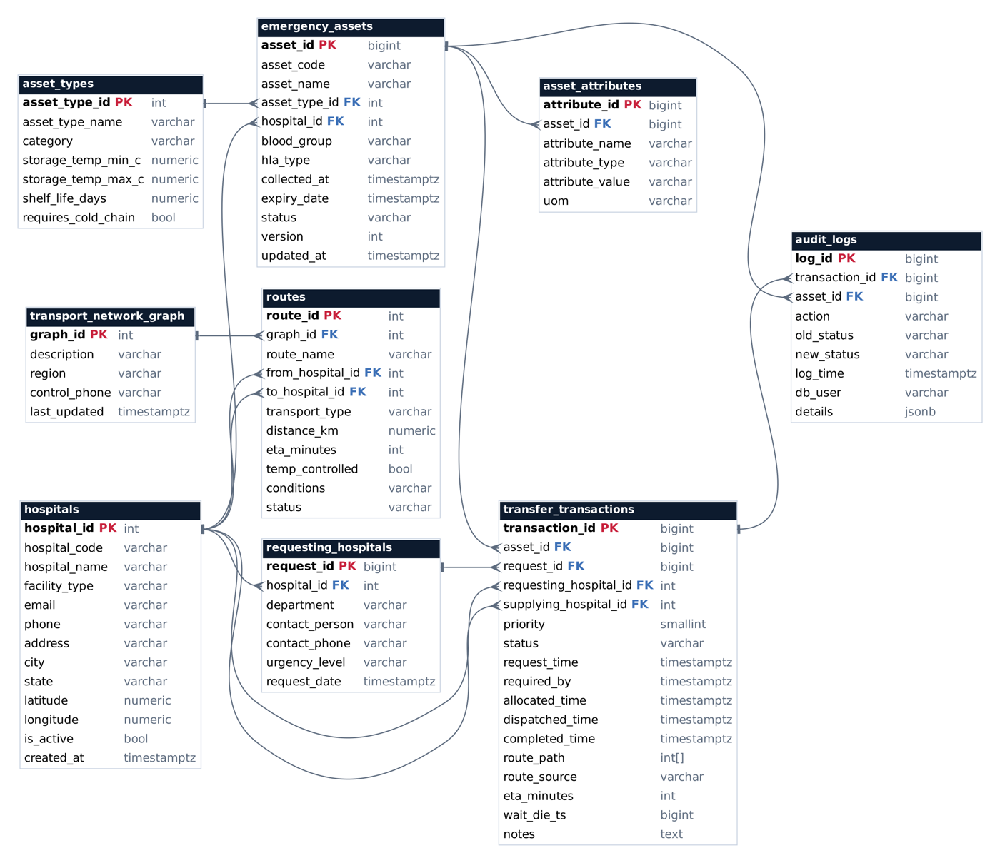

# MedMatch — Inter-Hospital Rare Resource Logistics Network

A conflict-safe reservation and routing network that lets independent hospitals find, reserve and move scarce medical assets — rare blood, antivenom and donor organs — without ever promising the same unit to two hospitals.

**Repository:** https://github.com/akshith-types/medmatch

Built for the **Database Systems Lab (BCSE302P)** at VIT Vellore by **Akshith M (24BAI0017)** and **Sanjaay B (24BCE2181)**.



## Highlights

- **No double allocation.** Every reservation is one ACID transaction using strict two-phase locking with `SELECT … FOR UPDATE`. With 15 hospitals reserving the same unit at once, exactly 1 succeeds.
- **Deadlock prevention.** A Wait-Die lock manager (S/X compatibility matrix) prevents the deadlocks PostgreSQL would otherwise have to detect: about 0.45 s versus 1.4 s.
- **Fast search.** Composite B+ tree, hash and partial indexes make the core lookups 12×–96× faster than sequential scans on 20,000 units.
- **Rules inside the database.** CHECK and UNIQUE constraints, 5 triggers (state machine, expiry guard, automatic audit, append-only audit log), 4 functions, 3 stored procedures and 4 views.
- **Graph routing.** Neo4j computes the fastest route with Dijkstra, using only refrigerated legs for cold-chain items. If Neo4j is down, an in-memory NetworkX fallback takes over.

## Tech stack

| Layer | Technology |
|---|---|
| Relational database | PostgreSQL 16 (PL/pgSQL) |
| Graph database | Neo4j 5 + APOC |
| Backend | Python, FastAPI, psycopg 3, NetworkX |
| Frontend | HTML, CSS, JavaScript |
| Infrastructure | Docker Compose |

## Quick start

Requirements: **Docker Desktop** (running) and **Python 3.9+**.

```bash
git clone https://github.com/akshith-types/medmatch.git
cd medmatch
./start.sh          # Windows: start.bat
```

The first run downloads PostgreSQL and Neo4j, creates the schema, loads 16 hospitals, 112 routes and 20,000 inventory units, and opens <http://localhost:8000>.

| URL | What |
|---|---|
| http://localhost:8000 | Web dashboard |
| http://localhost:8000/docs | REST API (Swagger) |
| http://localhost:7474 | Neo4j Browser (`neo4j` / `medmatch123`) |

Open a database shell with:

```bash
docker exec -it medmatch-postgres psql -U medmatch -d medmatch
SET search_path TO medmatch;
```

## Guided demo

```bash
./demo.sh            # 12 steps, press Enter between them
./demo.sh 6          # jump to step 6
./demo.sh --auto     # run straight through
```

Individual experiments:

```bash
source .venv/bin/activate
python scripts/concurrency_demo.py      # lost update vs 2PL; deadlock detection vs Wait-Die
python scripts/benchmark_indexes.py     # EXPLAIN ANALYZE with and without indexes
python scripts/load_graph.py            # resync routes into Neo4j
```

## Screenshots

| Transfers | Cold-chain routing |
|---|---|
|  |  |

| Concurrency lab | Audit trail |
|---|---|
|  |  |

## Database design

Nine tables in 3NF / BCNF: `hospitals`, `asset_types`, `emergency_assets`, `asset_attributes`, `requesting_hospitals`, `transfer_transactions`, `audit_logs`, `transport_network_graph` and `routes`, joined by 13 foreign keys.



Neo4j holds a synced copy of the network: `(:Hospital)` nodes connected by `[:ROUTE_TO]` relationships weighted by `eta_minutes`, plus `[:COLD_ROUTE]` for refrigerated legs.

## How a reservation works

1. The Wait-Die lock manager grants an exclusive lock on the unit, or aborts the younger transaction, which retries with its original timestamp.
2. `BEGIN; SELECT … FOR UPDATE` locks the row in PostgreSQL.
3. Status, expiry and ownership are re-checked under the lock.
4. The unit becomes `RESERVED`, the request and transfer rows are inserted, and a trigger writes the audit entry.
5. Neo4j returns the fastest cold-chain-safe route, which is stored on the transfer.
6. `COMMIT` releases all locks together (strict 2PL).

## Project layout

```
app/         FastAPI backend, lock manager, routing, dashboard (static/)
db/          SQL: schema, functions & triggers, indexes & views, master data
scripts/     setup, Neo4j loader, concurrency demo, index benchmark
reports/     generated index benchmark
submission/  final presentation and project report
docs/        screenshots and diagrams
```

## Known limitations

- No authentication; "Acting as" is a demo selector.
- The lock manager lives in one process, so deadlock prevention does not span multiple app servers (row-level locking still keeps data correct).
- Stale units are marked `EXPIRED` at server start rather than on a schedule; searches always filter by expiry.
- Route times are estimates, not live traffic.

## Authors

- Akshith M — 24BAI0017
- Sanjaay B — 24BCE2181
